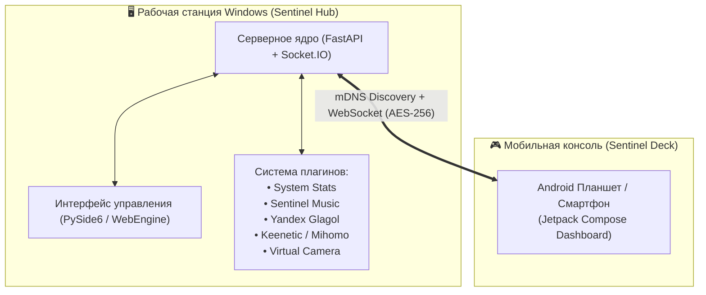

<div align="center">

# 🖥️ Sentinel Hub

### Сервер телеметрии ПК, драйверов и хаб умного дома для экосистемы Sentinel

[](https://microsoft.com/windows)
[](https://www.python.org/)
[](https://fastapi.tiangolo.com/)
[](https://www.qt.io/)
[](https://github.com/blackalex1)
[](LICENSE)

<p align="center">
  Центральный серверный компонент экосистемы <b>Sentinel</b> для персонального компьютера. Отвечает за сбор телеметрии железа, управление питанием и звуком, трансляцию видеопотока веб-камер и сетевую интеграцию с мобильной консолью <b>Sentinel Deck</b>.
</p>

</div>

---

## 🌟 Основные модули и плагины

* **⚡ Телеметрия ПК (System Stats):**
  * Сбор в реальном времени частот, температур и загрузки CPU и GPU (интеграция с LibreHardwareMonitor и MSI Afterburner).
  * Мониторинг использования ОЗУ и состояния накопителей (SSD/HDD).
* **🎵 Медиа-шлюз (Media Hub):**
  * **Sentinel Music**: прямое подключение к Sentinel Connect (WSS) с синхронизацией треков и караоке-текстов.
  * **Яндекс.Станции**: локальное управление колонками через Glagol API по Wi-Fi.
  * **PC Media**: перехват и управление громкостью и плеерами Windows (GSMTC).
* **🌐 Сетевой шлюз (Keenetic & Mihomo):**
  * Опрос статистики сетевого трафика с роутеров Keenetic через RCI API.
  * Управление правилами и прокси-нодами Mihomo (Clash Meta).
* **📹 Драйвер виртуальной камеры (Virtual Camera):**
  * Интеграция UnityCapture для захвата видеопотока с камеры Android (Sentinel Deck) через RTSP/ADB с минимальной задержкой.
* **🚀 Панель макросов (App Launcher):**
  * Удаленный запуск программ, выполнение консольных команд, эмуляция клавиатурных сочетаний (hotkeys) и перевод ПК в режим сна / блокировки.
* **🔒 Безопасность и сопряжение:**
  * Защита локальных сокетов одноразовыми токенами сопряжения с экрана ПК.
  * Автообнаружение через Zeroconf (mDNS `_monithome._tcp.local.`).
  * Шифрование секретов в локальной БД (AES-256).

---

## 🏛 Архитектура



---

## 🚀 Быстрый запуск

### 1. Установка зависимостей
Требуется **Python 3.10+**.

```bash
git clone https://github.com/blackalex1/sentinel-hub.git
cd sentinel-hub

# Создание и активация виртуального окружения
python -m venv venv
.\venv\Scripts\activate

# Установка зависимостей
pip install -r requirements.txt
```

### 2. Запуск приложения

```bash
# Запуск с графическим интерфейсом в трее
python pc_v2/pc_gui_app.py

# Или фоновый запуск только сервера
python pc_v2/main.py
```

### 3. Запуск тестов

```bash
pytest pc_v2/tests
```

---

<div align="center">
Часть экосистемы <b>Sentinel</b> • Разработано с ❤️
</div>
